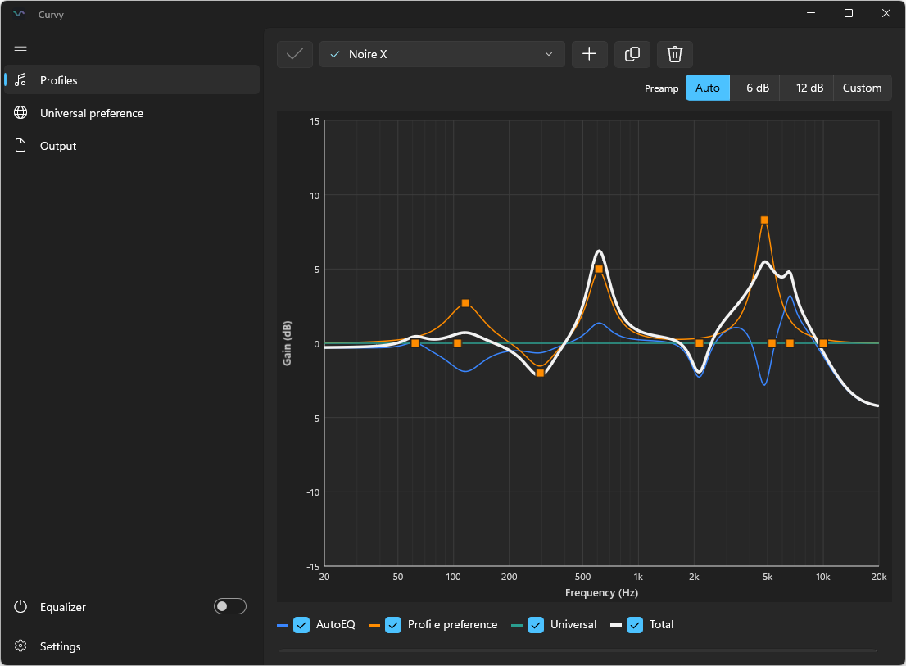

<div align="center">


# Curvy

**A simple companion app for [Equalizer APO](https://sourceforge.net/projects/equalizerapo/) and [AutoEQ](https://github.com/jaakkopasanen/AutoEq).**

AutoEQ corrections for your headphones, your own taste on top, switchable from the tray.

[](https://github.com/Kununa/Curvy/releases/latest)
[](https://github.com/Kununa/Curvy/releases)


### [⬇ Download for Windows](https://github.com/Kununa/Curvy/releases/latest/download/Curvy.App-win-Setup.exe)

</div>

<p align="center">
  
</p>

## Built on

- **[Equalizer APO](https://sourceforge.net/projects/equalizerapo/)**: the system-wide equalizer
  that does the actual sound processing.
- **[AutoEQ](https://github.com/jaakkopasanen/AutoEq)** by Jaakko Pasanen: corrections built from
  measurements by oratory1990, crinacle, Rtings and others.

Curvy is just the front end. If it helps you, consider supporting them.

## Features

- 🎧 **Headphone correction**: search your headphones, pick a measurement source, done.
- 🎚️ **Your taste on top**: bass, treble, or your own bands, per headphone or for all of them.
- 🗂️ **Tray switching**: 
- 🔄 **Automatic updates**.

## Get started

1. Install [Equalizer APO](https://sourceforge.net/projects/equalizerapo/) and select your
   headphones' output device in its setup.
2. Install [Curvy](https://github.com/Kununa/Curvy/releases/latest/download/Curvy.App-win-Setup.exe)
   (no admin rights needed).
3. Create a profile with **+** and search for your headphones.

> [!NOTE]
> The installer isn't code-signed yet. If SmartScreen warns, click **More info → Run anyway**.

## Questions

<details>
<summary><b>Will Curvy break my Peace or Equalizer APO setup?</b></summary>

No. Curvy offers to turn off other active EQs so they don't stack, keeps a backup, and
**Settings → Restore original config.txt** undoes everything.
</details>

<details>
<summary><b>My headphones aren't found.</b></summary>

Try just the model name. If AutoEQ doesn't have them, add your own bands by hand.
</details>

<details>
<summary><b>How do I uninstall?</b></summary>

Windows Settings → Apps → Curvy. Your Equalizer APO setup is restored. Profiles stay in
`%LocalAppData%\Curvy` until you delete that folder.
</details>

## Development

Needs Windows and the [.NET 11 SDK](https://dotnet.microsoft.com/download).

```powershell
dotnet run --project src/Curvy.App
dotnet test --project tests/Curvy.Core.Tests
```

To keep your real setup untouched, point Curvy at scratch folders first:

```powershell
$env:CURVY_APO_CONFIG_DIR = "$env:TEMP\apo-config"
$env:CURVY_DATA_DIR       = "$env:TEMP\curvy-data"
```

Requirements, design decisions, release builds and releasing: [docs/SPEC.md](docs/SPEC.md).
